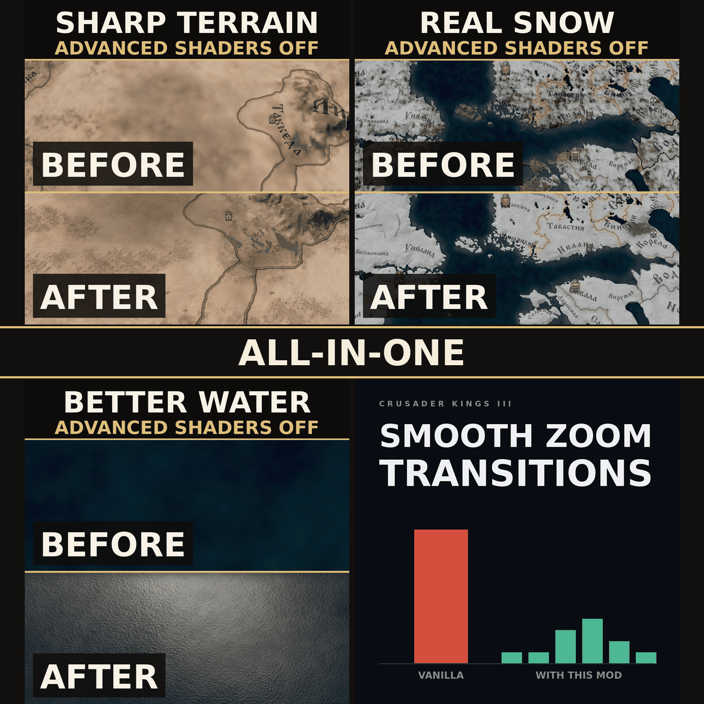

# All-in-One Map Pack Without Advanced Shaders (CK3)

Four map mods for playing with the graphics option **Advanced Shaders** off, in one
item instead of four:

* [Sharp Terrain Without Advanced Shaders](https://github.com/mekedron/ck3-lowspec-terrain-fix) -
  full resolution ground textures instead of the blurry low spec watercolour
* [Real Snow Without Advanced Shaders](https://github.com/mekedron/ck3-lowspec-real-snow) -
  the high spec snow material instead of flat blotches
* [Better Water Without Advanced Shaders](https://github.com/mekedron/ck3-lowspec-water) -
  animated waves, sun highlight and sky reflection on the ocean and lakes
* [Smooth Zoom Transitions](https://github.com/mekedron/ck3-zoom-transition-fix) -
  the two zoom hitches spread over neighbouring zoom steps

For the vanilla map. It is the same files as the four mods with Real Snow switched on,
so it looks and costs exactly the same as that playset. The separate mods stay
available and are the way to go for anyone who wants only some of the four.

**Guide:** [CK3 on a potato PC: a locked 60 FPS, and the map still looks sharp](https://steamcommunity.com/sharedfiles/filedetails/?id=3800254441) -
the full settings list these mods are built around.

## Why four mods in the first place

The engine compiles shaders with a fixed set of defines driven by the game's own
graphics options, and a mod cannot add an entry to the settings menu that reaches the
shader compiler. A feature that should be optional - real snow costs a few
milliseconds in winter - can only be made optional by being a separate mod. Real Snow
is therefore a one-file add-on that switches an option on in Sharp Terrain, Better
Water stands alone, and Smooth Zoom touches no shaders at all. This pack is the
answer for those who want all of it anyway.

## Contents

Every file is a byte copy from one of the four repositories; nothing is edited here.

    gfx/FX/pdxterrain.shader                    Sharp Terrain
    gfx/FX/lowspec_disease.fxh                  Sharp Terrain (epidemic hook, no-op)
    gfx/FX/sharp_terrain_options.fxh            Real Snow (the snow option on)
    gfx/FX/pdxwater.shader                      Better Water
    gfx/FX/jomini/jomini_water_default.fxh      Better Water
    gfx/FX/better_water_options.fxh             Better Water
    gfx/map/map_object_data/*.txt               Smooth Zoom Transitions
    common/defines/graphic/zz_smooth_zoom_*     Smooth Zoom Transitions

None of the four mods writes a file another one writes, apart from
`sharp_terrain_options.fxh`, which Real Snow exists to replace. The descriptions of
what each change does, its cost and its trade-offs live in the source repositories.

## Using it

* Enable it **instead of** the four separate mods, not together with them. With both
  in a playset the lower copy of each file wins, which after an update of one side is
  a mix of two versions.
* Keep Advanced Shaders **off**. With it on, the shader parts do nothing; Smooth Zoom
  works either way.
* Options: the snow material and both water options are on. To change one, edit
  `gfx/FX/sharp_terrain_options.fxh` or `gfx/FX/better_water_options.fxh` in the
  installed copy. The ultrawide name distance file of Smooth Zoom ships switched off
  as `zz_smooth_zoom_05_ultrawide.txt.off`; rename it to `.txt` to enable it.
* [Visible Epidemics Without Advanced Shaders](https://github.com/mekedron/ck3-lowspec-epidemics)
  works with this pack exactly as with Sharp Terrain: place it **below** the pack.
* Not for **A Game of Thrones**. AGOT needs the separate mods and their AGOT patches,
  which are built against the separate mods.

## Layout

    descriptor.mod                  mod metadata
    thumbnail.png                   Workshop preview, must sit in the mod root
    gfx/, common/                   the mod, generated by tools/sync.sh
    install.sh                      copies the mod into the Proton prefix
    tools/sync.sh                   rebuilds gfx/ and common/ from the four repositories
    tools/check_log.sh              mount and shader error check after a game start
    tools/bbcode_to_plain.py        Paradox Mods texts from the Steam ones
    steam-workshop/                 listing texts and the thumbnail generator

## Updating

The four repositories must sit next to this one. After a release of any of them:

    tools/sync.sh

It refuses to run if two sources ever ship the same path (other than the snow options
file), and prints the commit and version of each source - put those versions into the
release commit message. Then raise `version` in `descriptor.mod`, re-run `install.sh`
and upload from the launcher.

## Installing

Run `./install.sh`. It copies the mod into the CK3 mod directory inside the Proton
prefix. Then enable it in the launcher playset and disable the four separate mods. The
first map load is slower while the shaders recompile.

## Game version

Built against 1.20.0.2 (Crozier) from Sharp Terrain 2.0.0, Real Snow 1.2.0, Better
Water 2.0.0 and Smooth Zoom Transitions 1.1.0.

## Multiplayer / achievements

Graphics only: no gameplay, script or history files are changed, so ironman and
achievements are unaffected, and it can be added or removed mid-campaign.
